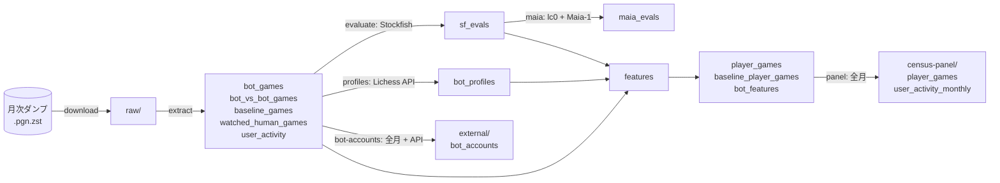
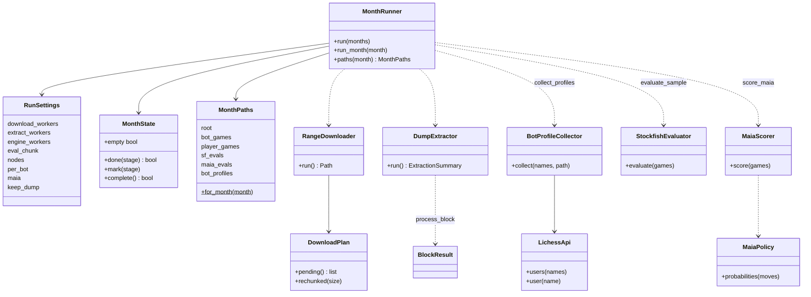
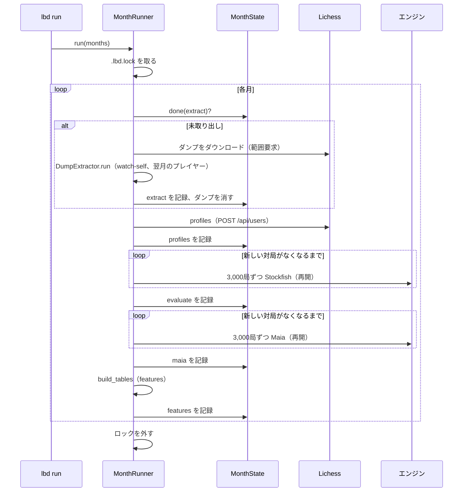

# アーキテクチャ

> English version (primary): [architecture.md](architecture.md)

`lichess_bot_data` はバッチのパイプラインである。各段階は1つの月のフォルダ（`<data>/interim/YYYY-MM/`）の Parquet ファイルを読み書きするので、段階ごとに単独で実行し直せる。終わった段階は、目印のファイル `.<stage>_done` に記録される。

## 段階とデータの流れ

| 段階 | モジュール | 内容 |
|---|---|---|
| download | `download.py` | 少数の並列接続による、再開できる HTTP の範囲ダウンロード。進み具合は付随の JSON に記録する |
| extract | `extract.py`、`pgn.py` | zstd のダンプを対局の境で区切ったブロックに分け、プロセスプールで処理する。人間対BOTの対局は指し手ごと、それ以外の種類は指し手なしで残す |
| profiles | `bots.py`、`api.py` | ボットの公開プロフィールを取得し（1回の要求で300件）、キーワードでエンジンの系統を分類する |
| evaluate | `engine.py` | すべての局面を Stockfish で評価する。区切りごとに保存する |
| maia | `maia.py` | レーティングに合わせた Maia-1 のネットワークが、各手を指す確率 |
| features | `features/*.py`、`pipeline.py` | プレイヤー側の表、考慮時間、エンジンに基づく指標、名前の表記の統一、系列の結果、コードブックによる系統、ボットごとの集計 |
| panel | `panel.py` | 月を縦に積み、月の境をまたいで系列を作り直し、28日・91日とどのボットへの再訪を加える |
| bot-accounts | `features/bot_accounts.py` | どれかの月で BOT として現れたすべてのアカウントの小文字の id と、API で確かめた称号なしのアカウント |
| run / status | `runner.py`、`cli.py` | 月の範囲について段階を順に実行し、目印から再開する |

## クラス

features の段階は、クラスではなく関数の組である。`build_player_table`（1局を注目するプレイヤーの側から見た1行）、`canonicalise`（小文字の id ごとに表記を1つにする）、`annotate_sequences`（再戦、セッション、7日再訪）、`apply_codebook`、`aggregate_bot_features` を、`pipeline.build_tables` がこの順に呼ぶ。

## `lbd run` の1か月

## 結果の変数の定義

`features/sequences.py`（`SequenceConfig`）と `panel.py` で決めている。

- **再戦**：プレイヤーの次の対局が同じボットとのもので、この対局の終わりから120秒以内に始まること。
- **セッション**：1体のボットとの対局で、間隔（終わりから次の始まりまで）が30分以内で続くもの。
- **N日以内の再訪**：セッションの最後の対局の後、30分より後、N日以内に同じボットとまた指すこと。期間がデータの最後の対局を越えるときは欠測にする（月の表ではその月の中で、パネルではパネル全体で）。
- **対局の終わり**は、開始時刻に測った考慮時間を足して推定する。時間切れのときは、時間切れになった側の残り時間も足す。

## 設計についての注記

- すべての書き込みは `io.write_parquet_atomic` を通るので、途中で落ちても、古いファイルが残るかファイルがないかのどちらかになる。
- エンジンのプロセスはバッチごとに起動し、タスクの中で終了させる。python-chess のエンジンをプールのワーカーに残すと、ワーカーが終了できなくなる。
- 2023年12月〜2024年9月のダンプでは名前の大文字・小文字が揺れるので、系列は `canonicalise` の後で作り、活動やプロフィールとの結合は小文字の id で行う。
