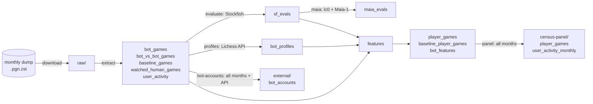
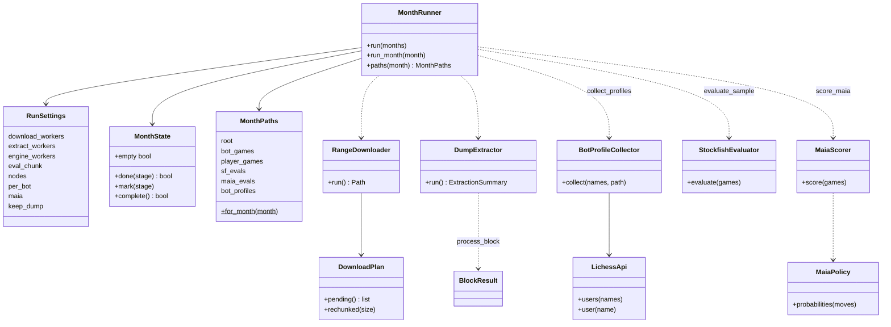
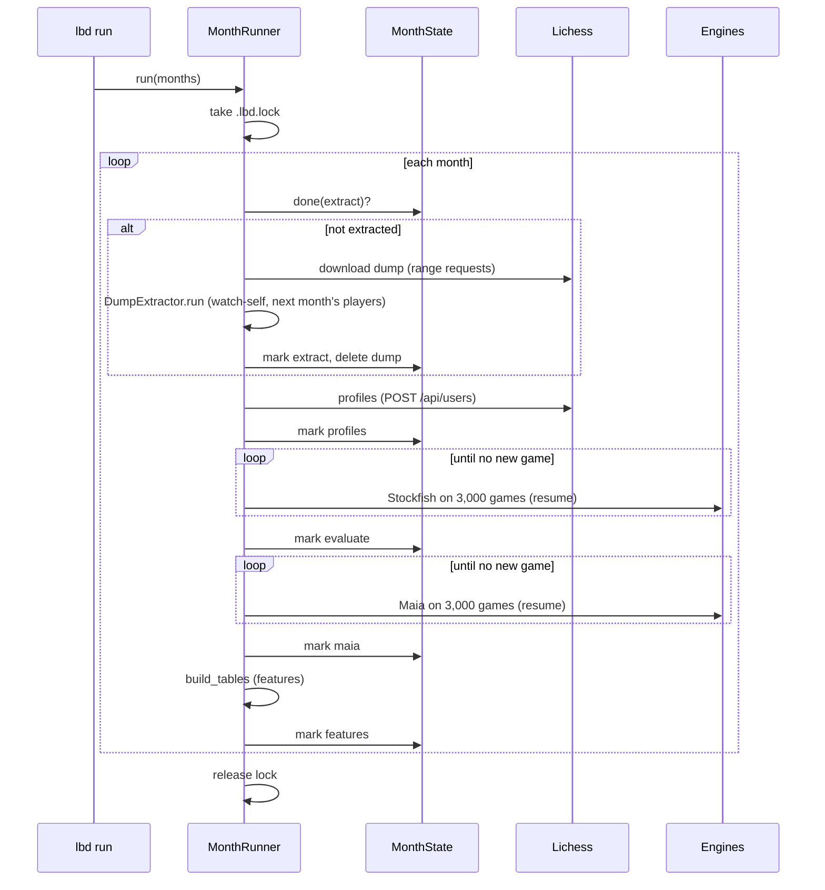

# Architecture

> Japanese version: [architecture.ja.md](architecture.ja.md)

`lichess_bot_data` is a batch pipeline. Each stage reads and writes Parquet files in one month folder (`<data>/interim/YYYY-MM/`), so a stage can be rerun on its own, and a marker file `.<stage>_done` records what is finished.

## Stages and data flow

| Stage | Module | What it does |
|---|---|---|
| download | `download.py` | Resumable HTTP range download with a few parallel connections; progress in a sidecar JSON |
| extract | `extract.py`, `pgn.py` | Streams the zstd dump in game-aligned blocks through a process pool; keeps human-vs-BOT games with moves, other kinds without |
| profiles | `bots.py`, `api.py` | Fetches the bots' public profiles (300 per request) and classifies their engine family by keywords |
| evaluate | `engine.py` | Stockfish evaluation of every position, in checkpointed chunks |
| maia | `maia.py` | Probability that the rating-matched Maia-1 network plays each move |
| features | `features/*.py`, `pipeline.py` | Player-side table, think times, engine measures, canonical names, sequence outcomes, codebook families, bot aggregates |
| panel | `panel.py` | Stacks months, rebuilds sequences across month boundaries, adds 28- and 91-day and any-bot returns |
| bot-accounts | `features/bot_accounts.py` | Lowercase ids of every account shown as BOT in any month, plus untitled accounts confirmed by the API |
| run / status | `runner.py`, `cli.py` | Runs the stages of a month range in order and resumes from the markers |

## Classes

The features stage is a set of functions rather than classes: `build_player_table` (one row per game from the focal player's side), `canonicalise` (one spelling per lowercase id), `annotate_sequences` (rematch, session, 7-day return), `apply_codebook` and `aggregate_bot_features`, called in that order by `pipeline.build_tables`.

## One month in `lbd run`

## Outcome definitions

They are fixed in `features/sequences.py` (`SequenceConfig`) and `panel.py`:

- **Rematch**: the player's next game is against the same bot and starts within 120 s of this game's end.
- **Session**: games against one bot whose gaps (end to next start) are at most 30 minutes.
- **Return within N days**: after a session's last game, the same bot is played again more than 30 minutes and at most N days later. It is null when the window runs past the last game of the data (per month for the month tables, over the whole panel for the panel).
- **Game end** is estimated from the start time plus the measured move times, plus the flagging side's remaining clock in a time forfeit.

## Design notes

- Every write goes through `io.write_parquet_atomic`, so a crash leaves the old file or none.
- Engine processes are started per batch and quit inside the task: a python-chess engine kept in a pool worker blocks the worker's exit.
- Names are case-varied in the December 2023 – September 2024 dumps, so sequences are built after `canonicalise`, and joins with activity and profiles use lowercase ids.
